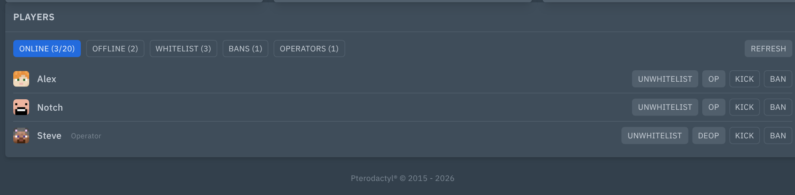
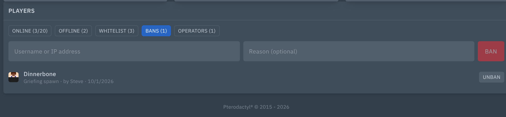
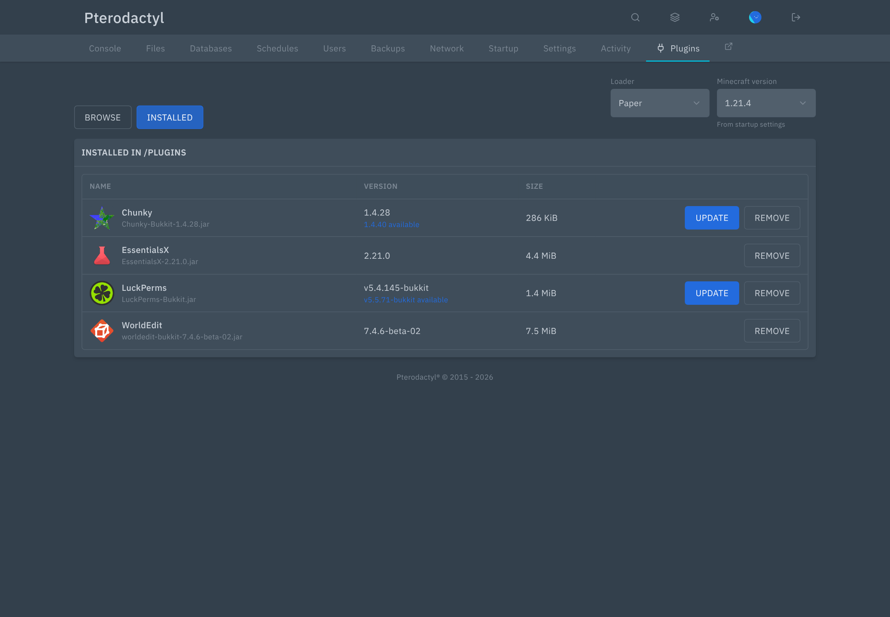
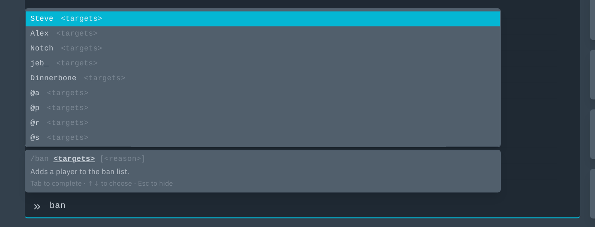

# Pterodactyl 2.0 Extensions

Free, open-source extensions for **Pterodactyl Panel 2.0** that turn the panel into a real game-server control room: install Minecraft plugins and mods from Modrinth, manage players across all your servers, switch Minecraft versions, back up and reset worlds, run ARK and Terraria servers without touching config files.

Built for and used every day on a home-hosted panel with Minecraft (Paper, Fabric, a Waterfall network), ARK: Survival Evolved and Terraria servers.

[](https://github.com/Enforcer0952/pterodactyl-v2-extensions/releases/latest)
[](https://github.com/Enforcer0952/pterodactyl-v2-extensions/releases)
[](https://github.com/Enforcer0952/pterodactyl-v2-extensions/actions/workflows/ci.yml)
[](LICENSE)


> **Pterodactyl 2.0 only.** These use the panel's new native extension system (`p:extension:*`). They do not work on Pterodactyl 1.x or with Blueprint.

## Extensions

**[Download the latest release](https://github.com/Enforcer0952/pterodactyl-v2-extensions/releases/latest)**: one `.pteroext` file per extension. Install only the ones you need; each one only shows up on servers it fits.

### Minecraft

| Extension | What it does |
|---|---|
| [**Minecraft Content**](extensions/mc-content) | **Plugins** and **Mods** pages: search Modrinth, open any project in an in-panel page (description, gallery, versions, changelogs, dependencies), install, update or remove in one click. Detects the loader and Minecraft version, installs dependencies and recognises jars you uploaded yourself. Paper, Purpur, Folia, Spigot, Bukkit, Sponge, Velocity, Waterfall, BungeeCord, Forge, NeoForge, Fabric, Quilt. |
| [**Minecraft Players**](extensions/mc-players) | **Players** card under the console: online and offline players, whitelist, bans and operators with one-click actions, also while the server is stopped. Click a player for a profile with a 3D skin, stats, MCBans history, and the same player on every server you run, with actions on one or all of them. |
| [**Minecraft Console**](extensions/mc-console) | Command autocomplete in the console: vanilla and plugin commands with syntax hints, player names, Tab to complete. |
| [**Minecraft Version**](extensions/mc-version) | **Version** page: see what a server really runs, switch between Paper, Purpur, Fabric and Vanilla or to another Minecraft version, with the right Java image picked for you and a one-click way back. |
| [**Minecraft World**](extensions/mc-world) | **World** page: back up, restore, reset and switch worlds, a "new hardcore run" button, and a proper form for `server.properties`. |
| [**Minecraft Network**](extensions/mc-network) | **Network** page on BungeeCord and Waterfall proxies: every backend matched to its panel server with live state, broken entries flagged (wrong ports, duplicates, missing names) and fixed without editing YAML. |

### ARK: Survival Evolved

| Extension | What it does |
|---|---|
| [**ARK Tools**](extensions/ark-tools) | Steam Workshop mod manager with update checks, a **Config** page for `GameUserSettings.ini` and `Game.ini` (presets like 2x/5x/10x, problem check, safe apply with stop and start), players, whitelist, bans and admins, admin buttons, safe restarts with an in-game countdown, daily restarts and RCON command autocomplete. |

### Terraria

| Extension | What it does |
|---|---|
| [**Terraria Tools**](extensions/terraria-tools) | Online players with kick and ban, ban list, admin buttons (save, settle, time of day, broadcast), **Worlds** page with backups, restore and new worlds, a **Server settings** page for `serverconfig.txt`, and console autocomplete. For vanilla Terraria servers. |

More games are on the way. [Ask for yours](https://github.com/Enforcer0952/pterodactyl-v2-extensions/issues/new?template=feature_request.yml).

## Screenshots

| | |
|---|---|
|  **Minecraft Players**: online players with actions |  Bans with reason, source and date |
|  **Minecraft Content**: installed plugins with updates |  **Minecraft Console**: autocomplete with player names |
|  **ARK Tools**: Workshop mods |  ARK admin actions and safe restarts |

## Install

1. Download the `.pteroext` files you want from the [latest release](https://github.com/Enforcer0952/pterodactyl-v2-extensions/releases/latest).
2. On your panel host, from the panel directory (usually `/var/www/pterodactyl`):

   ```bash
   sudo -u www-data php artisan p:extension:install /path/to/<extension>.pteroext --enable
   ```

   Or upload it under **Admin → Extensions**.
3. Hard-refresh the panel (Ctrl+Shift+R).

**Update** the same way with `--replace`. Settings and data are kept.

Each extension's README lists the eggs it works with, its settings and its subuser permissions.

### Verify a download

Every release lists a SHA-256 digest next to each file, and ships a `SHA256SUMS.txt`:

```bash
sha256sum --check --ignore-missing SHA256SUMS.txt
```

## Requirements

- Pterodactyl Panel 2.0 (2.0.0-beta or newer)
- PHP 8.3+ (same as the panel)
- The panel server needs outbound HTTPS for the extensions that talk to outside services (Modrinth, Steam, PaperMC, Mojang, mc-heads, MCBans). Everything else runs through the panel and Wings.

## Build from source

The extension SDK ships with the panel, so build next to a panel checkout:

```bash
git clone https://github.com/pterodactyl/panel.git -b 2.0-develop
git clone https://github.com/Enforcer0952/pterodactyl-v2-extensions.git
cd panel && npm ci && npm run sdk:generate && cd ..

# The extensions expect the SDK at ../../packages/sdk
ln -s ../panel/packages pterodactyl-v2-extensions/packages

cd pterodactyl-v2-extensions/extensions/mc-content
npm install --legacy-peer-deps
npm run build && npm test
cd ../.. && composer install && (cd extensions/mc-content && ../../vendor/bin/phpunit)

# Pack every built extension, with checksums
php scripts/build-release.php extensions out
```

Releases are built the same way by the [Release workflow](.github/workflows/release.yml).

## Support and contributing

- Bugs: [open an issue](https://github.com/Enforcer0952/pterodactyl-v2-extensions/issues/new?template=bug_report.yml).
- Ideas and new games: [request a feature](https://github.com/Enforcer0952/pterodactyl-v2-extensions/issues/new?template=feature_request.yml).
- Pull requests are welcome.

If these save you time, the **Sponsor** button at the top of the page helps keep them going.

## About

Made by [Enforcer0952](https://github.com/Enforcer0952). Every extension runs on my own Pterodactyl 2.0 panel before it is released.

Not affiliated with or endorsed by Pterodactyl, Modrinth, Mojang/Microsoft, Valve, Studio Wildcard, Re-Logic or MCBans.

## License

[GPL-3.0](LICENSE)
