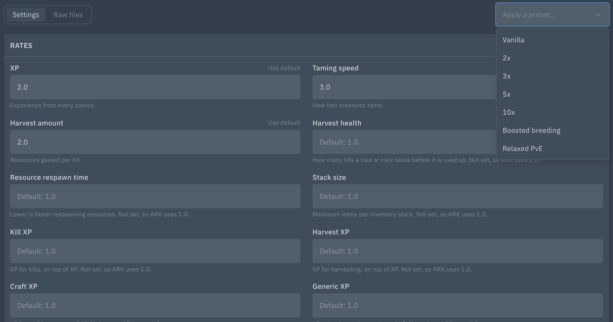
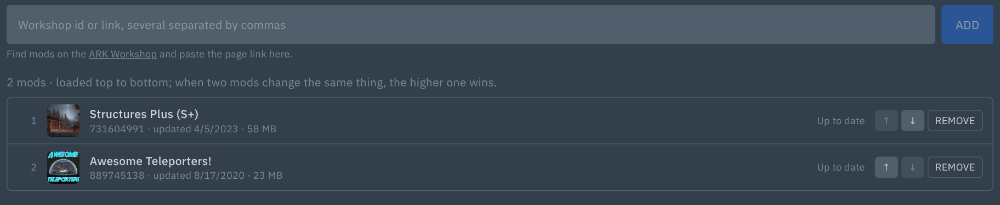
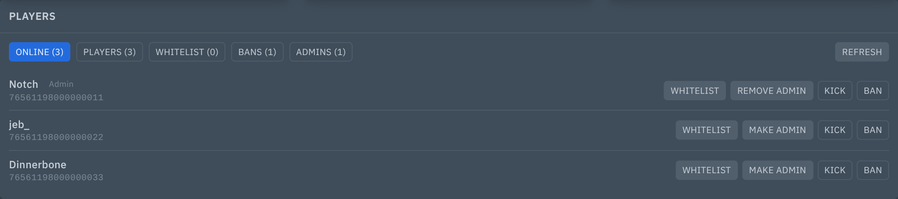
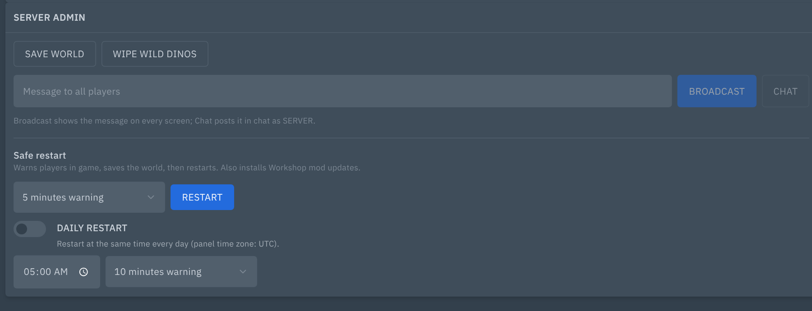

# ARK Tools: Workshop mods, server settings, players, admin and safe restarts for ARK: Survival Evolved

Adds **Mods** and **Config** pages and two console cards to ARK: Survival Evolved servers in Pterodactyl 2.0.






## Features

**Mods page**
- Add Steam Workshop mods by id or link; they're checked against the Workshop before adding.
- Reorder the load order, remove mods, and save as one change to `MOD_ID`.
- Status per mod: up to date, update on restart, or downloads on restart.
- Finds mods that are downloaded but not loaded, and lets you delete their files.

**Config page**
- `GameUserSettings.ini` and `Game.ini` as a form: about 90 common settings in groups (rates, breeding, survival, PvE, structures and more), each with its default.
- Presets: Vanilla, 2x, 3x, 5x, 10x, boosted breeding and relaxed PvE, with a preview of every change.
- Finds settings ARK ignores: lines in the wrong file or section, likely typos (`MaxNumbersofPlayersInTribe`), duplicates. One-click fixes.
- Marks settings the startup command overrides.
- Raw editor for everything else, including mod sections. Passwords stay hidden.
- Safe saving: ARK rewrites its config when it shuts down, so a running server gets a countdown, saves the world and stops; the files are written while it is off, then it starts again. Every save keeps the last five backups next to the file.

**Players card**
- Online players (via RCON `ListPlayers`) and every player seen before, with Steam ids and names.
- Kick, ban/unban, whitelist and admin list (`AllowedCheaterSteamIDs.txt`).
- Whitelist on/off switch (adds `-exclusivejoin` to the launch options).
- Works while stopped: list files are edited directly.

**Server admin card**
- Save world, wipe wild dinos, broadcast, server chat.
- **Safe restart** with in-game countdown warnings (1–30 min), world save, then restart. Can be cancelled.
- **Daily restart** at a fixed time, built on the panel's own Schedules.

**Console autocomplete**
- ARK RCON commands with syntax hints. Steam id arguments suggest players by name.

## Requirements

- Pterodactyl Panel **2.0** (2.0.0-beta or newer; tested on 2.0-develop, October 2026)
- PHP 8.3+ (same as the panel)
- No build step: the package ships prebuilt.
- The panel's scheduler (`php artisan schedule:run` every minute, as in the standard install) to write settings saved while the server was running.

## Install

1. Copy the `.pteroext` file to your panel server.
2. Run, from the panel directory (usually `/var/www/pterodactyl`):

   ```
   sudo -u www-data php artisan p:extension:install /path/to/ark-tools-1.1.3.pteroext --enable
   ```

   Or upload it under **Admin → Extensions**.
3. Hard-refresh the panel in your browser (Ctrl+Shift+R).

## Update

Same command with `--replace`:

```
sudo -u www-data php artisan p:extension:install /path/to/ark-tools-1.1.3.pteroext --enable --replace
```

Settings and data are kept.

## Setup

1. Give your ARK: Survival Evolved egg(s) the `ark` tag (Admin → Eggs → Tags).
2. The egg's console must be RCON-based, like the default Pterodactyl ARK egg (`rcon` piped to the console). Admin commands are sent as console commands.

## Permissions (Subusers)

| Permission | Allows |
|---|---|
| `ext.ark-tools.view` | See players and lists |
| `ext.ark-tools.kick` | Kick |
| `ext.ark-tools.ban` | Ban and unban |
| `ext.ark-tools.whitelist` | Whitelist changes |
| `ext.ark-tools.admin` | Admin commands and the admin list |
| `ext.ark-tools.restart` | Safe and daily restarts |
| `ext.ark-tools.config` | View and change the Config page (saving restarts a running server) |

The Mods page uses the core **startup.read** and **startup.update** permissions.

Actions also need the matching core permission: **control.console** for console commands and kicks, **control.start**, **control.stop** and **control.restart** for restarts and applying settings, and **file.update** for changes to settings and player lists.

## Support

Open an issue at https://github.com/Enforcer0952/pterodactyl-v2-extensions/issues. Please include your panel version and the error text or request ID.
