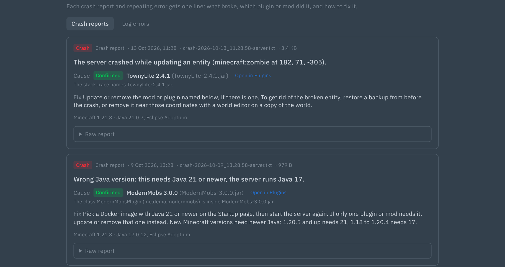
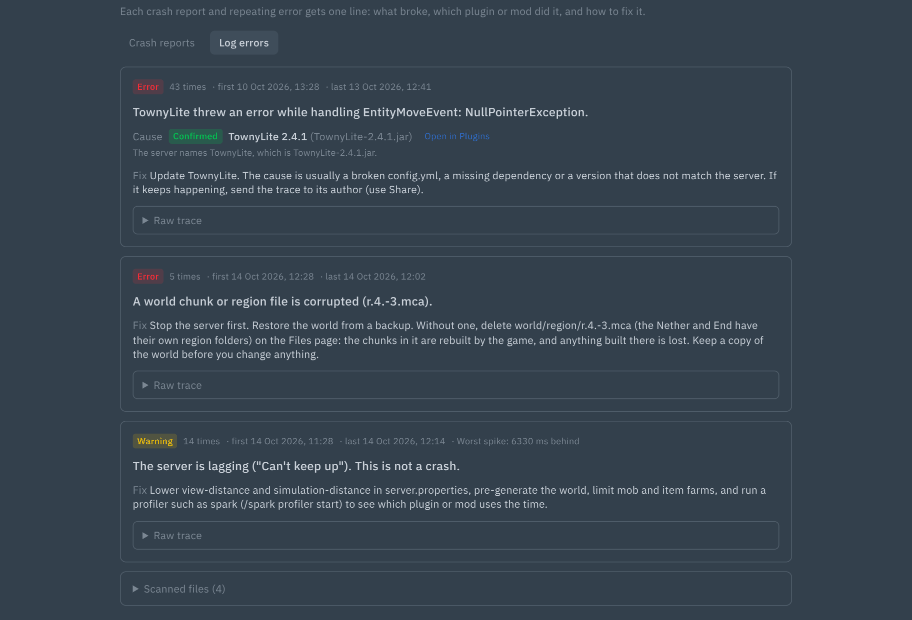

# Minecraft Crashes: what broke, which plugin or mod did it, and how to fix it

Adds a **Crashes** page to Minecraft servers in Pterodactyl 2.0. It reads crash reports and log errors and gives each one a one-line verdict with a plain fix.




## Features

- **Crash reports:** lists `crash-reports/*.txt`, the crash sections of Forge and NeoForge `logs/debug.log`, and `hs_err_pid*.log` in the server folder. Newest first, with time, verdict and severity.
- **Log errors:** scans `logs/latest.log` and the last 5 `logs/*.log.gz`. Repeated errors are grouped, counted and shown with first and last seen. Known noise is collapsed.
- **Culprit:** matches stack-frame packages to the jars in `plugins/` and `mods/` (`plugin.yml`, `paper-plugin.yml`, `fabric.mod.json`, `mods.toml`, `neoforge.mods.toml`, `quilt.mod.json`). **Confirmed** means exactly one jar matches. **Likely** means a best guess, and is labelled as one. Mixin errors that name a mod are recognised too.
- **Known problems with a fix:** wrong Java version, missing dependency (Fabric, Forge, Paper), mixin conflict or failure, out of memory, port in use, corrupt chunk, "Can't keep up", EULA not accepted, plugin API too new, and more. The rules live in `resources/rules.json`.
- **Open in Plugins or Mods:** a link to the matching jar, shown only when the Minecraft Content extension is installed.
- **Share:** uploads a report to mclo.gs after a confirm dialog that says the link is public. The raw trace is folded, with a copy button.
- **Console notice:** a small note under the console when a crash is newer than your last visit to the page.
- Works with proxies (BungeeCord, Waterfall, Velocity) too.
- Big files are handled safely: logs are read from their last 4 MB, compressed logs are unpacked as a stream with a size cap, and a huge `latest.log` falls back to the last 100 console lines.
- Results are cached per file (path, size and modified time), so reopening the page is fast.

## Requirements

- Pterodactyl Panel **2.0** (2.0.0-beta or newer; tested on 2.0-develop, October 2026)
- PHP 8.3+ with the `zip` extension (same as the panel)
- No build step: the package ships prebuilt.

## Install

1. Copy the `.pteroext` file to your panel server.
2. Run, from the panel directory (usually `/var/www/pterodactyl`):

   ```
   sudo -u www-data php artisan p:extension:install /path/to/mc-crash-1.0.0.pteroext --enable
   ```

   Or upload it under **Admin → Extensions**.
3. Hard-refresh the panel in your browser (Ctrl+Shift+R).

## Update

Same command with `--replace`:

```
sudo -u www-data php artisan p:extension:install /path/to/mc-crash-1.0.0.pteroext --enable --replace
```

Settings and data are kept.

## Setup

The page appears on servers whose egg has the `minecraft` tag (or `proxy`, `bungeecord`, `velocity`, `waterfall`), or the `eula` feature that every Java egg has. Bedrock servers are not covered.

The first time you open the page on a server with many jars, the jar index is built in a few steps and the page updates by itself.

## Settings

Under **Admin → Extensions → Minecraft Crashes**:

| Setting | Options |
|---|---|
| Sharing | On (default) or Off. When on, users with the share permission can upload a report to mclo.gs. Off hides the Share button. |

## Permissions (Subusers)

| Permission | Allows |
|---|---|
| `ext.mc-crash.view` | See the Crashes page. Also needs the core `file.read-content` permission. |
| `ext.mc-crash.share` | Upload a report to mclo.gs |

Server owners and admins have all of them.

## Support

Open an issue at https://github.com/Enforcer0952/pterodactyl-v2-extensions/issues. Please include your panel version and the error text or request ID.
