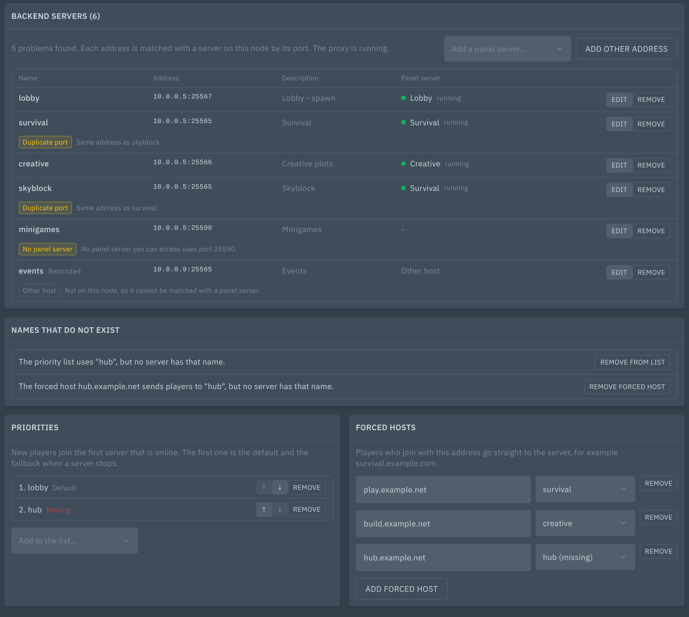

# Minecraft Network: manage a proxy's backend servers from the panel

Adds a **Proxy** page to BungeeCord and Waterfall proxy servers in Pterodactyl 2.0. It reads the proxy's `config.yml`, matches every backend with a server on the same node, points out what is broken, and lets you fix it without editing YAML by hand.



## Features

- **Backend table:** name, address, restricted, description (shown as plain text, without `&` and `§` colour codes), and the panel server behind it.
- **Panel server match:** each address is matched by port with the servers on the proxy's node. `localhost`, `127.0.0.1`, `0.0.0.0` and the node's own addresses and host name count as this node. The matched server shows its live state and links to its console.
- **Problem badges:**
  - the port matches no panel server you can access
  - the entry points at the proxy itself
  - the port belongs to a server that is not a Minecraft Java server
  - several entries use the same address
  - a name in the priority list or in the forced hosts has no server with that name
  - the address is not a valid host and port
  - other hosts (not on this node) are marked as such and are not an error
- **Easy fixes:** edit or remove an entry, remove or correct a missing name with one click, and rename a server everywhere at once.
- **Add a server:** pick one of your Minecraft servers from a list. The address is filled in as `localhost:<port>` and the name is suggested, and you can change both.
- **Edit:** address, name, restricted flag and description of every entry, the priority order (the first one is the default and the fallback), and the forced hosts.
- **Safe saving:** every other key in `config.yml` is kept. The old file is saved as `config.yml.bak-<date>` first (the newest five are kept). If the file changed after you opened the page, the save is refused and you reload first.
- **Restart proxy:** after a save the page reminds you that BungeeCord reads the file only when it starts, with a **Restart proxy** button.
- Checks every value before it is written: names, ports and host names. Values are quoted by the YAML writer, so nothing typed on the page can add a key to the file.
- Only the servers you can access are listed, so other people's servers never show up. Root admins see every server on the node.

Velocity (`velocity.toml`) is not supported yet. The page says so when the proxy has no `config.yml` but does have a `velocity.toml`.

## Requirements

- Pterodactyl Panel **2.0** (2.0.0-beta or newer; tested on 2.0-develop, October 2026)
- PHP 8.3+ (same as the panel)
- A proxy server whose egg has one of the tags `proxy`, `bungeecord`, `waterfall` or `velocity`
- No build step: the package ships prebuilt.

## Install

1. Copy the `.pteroext` file to your panel server.
2. Run, from the panel directory (usually `/var/www/pterodactyl`):

   ```
   sudo -u www-data php artisan p:extension:install /path/to/mc-network-1.0.1.pteroext --enable
   ```

   Or upload it under **Admin → Extensions**.
3. Hard-refresh the panel in your browser (Ctrl+Shift+R).

## Update

Same command with `--replace`:

```
sudo -u www-data php artisan p:extension:install /path/to/mc-network-1.0.1.pteroext --enable --replace
```

## Setup

Open the proxy server and click **Proxy** in the menu. It only appears on servers whose egg has one of the tags above. Add the tag under **Admin → Eggs → Tags** if your proxy egg has none.

Notes:

- Backends must run on the same node as the proxy to be matched. Entries on other hosts are listed but not checked.
- Saving rewrites `config.yml` with a YAML writer. Every key is kept, but comments and the original layout of the file are not.
- Only the first listener's priorities and forced hosts are shown and changed. Other listeners are left as they are.
- BungeeCord reads `config.yml` as YAML 1.1, where a plain `yes`, `no`, `on`, `off`, `y` or `n` is a boolean and `1:30` is a number. The writer would turn those into text, so a save is refused (with the key named) while such a plain value sits outside the parts this page edits. Write `true` or `false`, or put quotes around the value, and save again. After writing, every other key is compared with the original, and the save is refused if anything else would change.
- Server names need at least one character that is not a digit.
- Changes apply after the proxy restarts. Nothing is sent to the running proxy.

## Permissions

This extension adds no permissions of its own. It uses the panel's file and power permissions on the proxy server:

| Permission | Allows |
|---|---|
| `file.read` and `file.read-content` | See the Proxy page |
| `file.read-content`, `file.update` and `file.create` | Add, edit, remove and reorder, and save (the old file is saved as a backup copy first) |
| `control.restart` | The **Restart proxy** button |

Server owners and admins have all of them.

## Support

Open an issue at https://github.com/Enforcer0952/pterodactyl-v2-extensions/issues. Please include your panel version and the error text or request ID.
