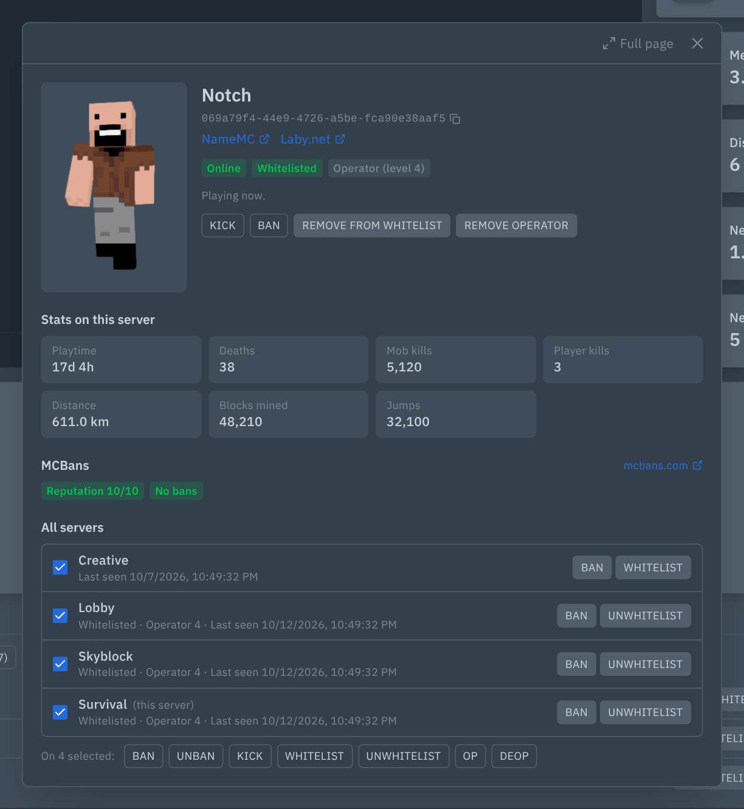

# Minecraft Players: players, whitelist, bans and ops on the console page

Adds a **Players** card under the console of Minecraft Java servers in Pterodactyl 2.0.





## Features

- **Online:** who is on right now (read with `list`), with Kick, Ban, Op and Whitelist buttons.
- **Offline:** everyone who has joined before (from `usercache.json`), with last-seen date and all actions.
- **Whitelist:** add or remove players, and turn the whitelist on or off.
- **Bans:** player and IP bans with reason, source and date, plus Unban.
- **Operators:** op and deop.
- Works while the server is **stopped** too: changes are written to `whitelist.json`, `ops.json`, `banned-players.json` and `server.properties`, and apply on the next start.
- Players who joined before keep the UUID the server recorded (right for offline mode, proxies and Floodgate). New players are looked up with Mojang on online-mode servers and get the offline UUID otherwise.
- A list file that is not valid JSON is never overwritten: the card shows what is wrong and leaves the file alone.
- Shows the server's own answer to a command, so "That player does not exist" is an error, not a success.
- Updates live from the console (joins, leaves, list changes), with no polling.
- Input is validated, so a name or reason can never inject a second console command.

### Player profile

Click any player name on the card to open their profile, as a popup over the console or as a full page (`/server/<id>/player/<name>`).

- **3D skin** you can rotate. The viewer loads only when a profile opens, so the console page stays light.
- **Name, UUID** (click to copy) and links to NameMC, Laby.net or mcuuid.net. Offline-mode UUIDs are marked as such, and profile links are left out for them.
- **This server:** online or not, whitelisted, operator level, ban with reason and source, last seen, with every action.
- **Stats** from the world's stats file: playtime, deaths, mob and player kills, distance, blocks mined, jumps.
- **MCBans:** the player's global ban history from [mcbans.com](https://www.mcbans.com): reputation, every ban with reason, server, admin and date. Only Mojang accounts are looked up, and results are cached for 30 minutes.
- **All servers:** the same player on every Minecraft server you can see players on (up to 30), with per-server actions and bulk Ban, Unban, Kick, Whitelist, Unwhitelist, Op and Deop on the servers you select. Each server is checked against your own permissions there.

## Requirements

- Pterodactyl Panel **2.0** (2.0.0-beta or newer; tested on 2.0-develop, October 2026)
- PHP 8.3+ (same as the panel)
- No build step: the package ships prebuilt.

## Install

1. Copy the `.pteroext` file to your panel server.
2. Run, from the panel directory (usually `/var/www/pterodactyl`):

   ```
   sudo -u www-data php artisan p:extension:install /path/to/mc-players-1.4.1.pteroext --enable
   ```

   Or upload it under **Admin → Extensions**.
3. Hard-refresh the panel in your browser (Ctrl+Shift+R).

## Update

Same command with `--replace`:

```
sudo -u www-data php artisan p:extension:install /path/to/mc-players-1.4.1.pteroext --enable --replace
```

Settings and data are kept.

## Setup

The card appears on servers whose egg has the `minecraft` tag, or the `eula` feature that every Java egg has. It's hidden for Bedrock (`bedrock` tag) and for proxies (BungeeCord, Waterfall, Velocity).

## Settings

Under **Admin → Extensions → Minecraft Players**:

| Setting | Options |
|---|---|
| Player skins | mc-heads.net (default), crafatar.com, or Off (no outside requests, default skin) |
| Skins on offline-mode servers | Look up by name (default) or default skin. crafatar.com only knows account UUIDs, so it always shows the default skin here. |
| Profile links | Any of NameMC, Laby.net, mcuuid.net |
| Clicking a player | Popup (default) or full page |
| MCBans lookup | On (default) or Off. When on, the player's UUID is sent to mcbans.com. |

## Permissions (Subusers)

| Permission | Allows |
|---|---|
| `ext.mc-players.view` | See the card |
| `ext.mc-players.kick` | Kick |
| `ext.mc-players.ban` | Ban, unban, IP bans |
| `ext.mc-players.whitelist` | Whitelist changes |
| `ext.mc-players.op` | Op and deop |

Server owners and admins have all of them.

## Support

Open an issue at https://github.com/Enforcer0952/pterodactyl-v2-extensions/issues. Please include your panel version and the error text or request ID.
