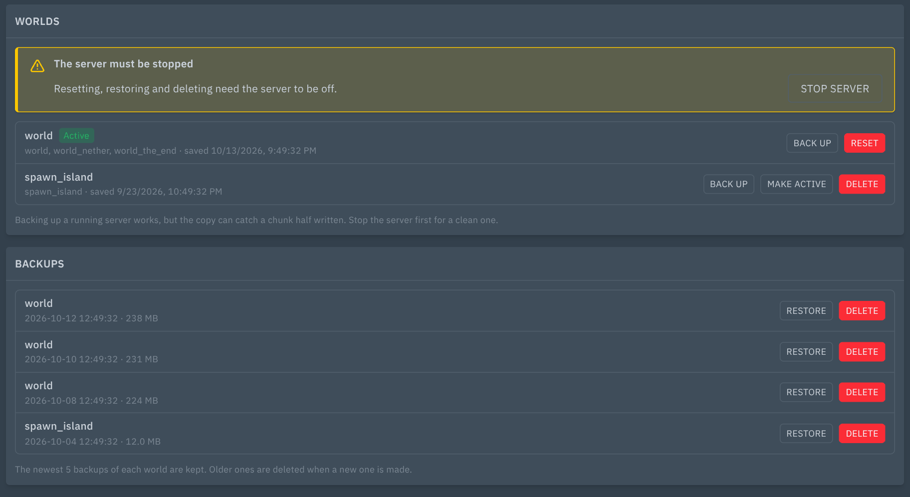
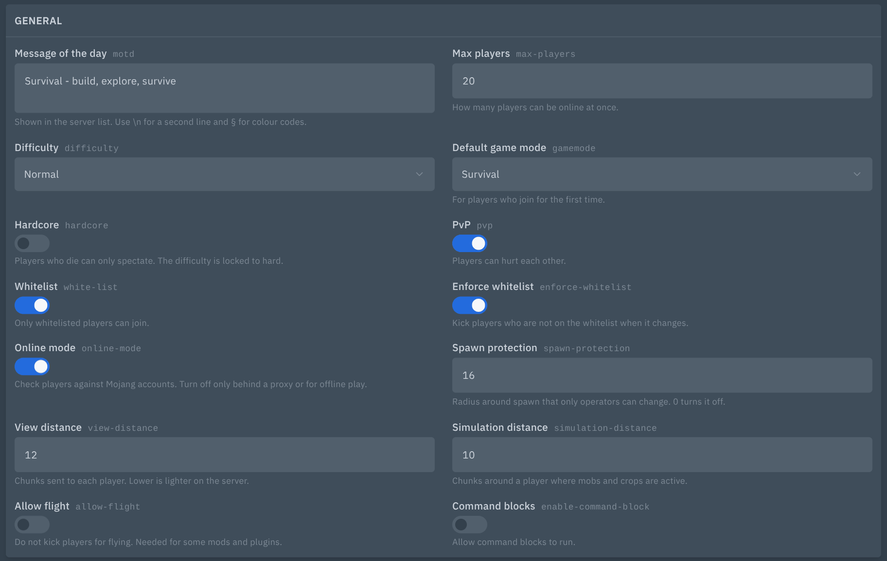

# Minecraft World: backups, world resets and a server.properties editor

Adds a **World** page to Minecraft Java servers in Pterodactyl 2.0. Back up, restore and reset worlds, switch between them, and edit `server.properties` with a proper form.




## Features

### Worlds

- Lists the world folders on the server (any folder with a `level.dat`), marks the **active** one (`level-name`) and shows when it was last saved.
- Works with Paper and Spigot (`world`, `world_nether`, `world_the_end`) and with vanilla and Fabric (nether and end inside `world`). The nether and end folders are treated as part of their world.
- **Back up:** compresses the world, with its nether and end folders, into `world-backups/<name>-<date>.tar.gz`. Only the newest backups of each world are kept (5 by default, see Settings).
- **Restore:** with the server stopped, the current folders are renamed to `<name>.old-<date>` (nothing is deleted) and the backup is unpacked. If unpacking fails, the old folders are put back.
- **Reset:** with the server stopped, deletes the active world and its nether and end folders and sets `level-seed`, so the server generates a fresh world on the next start. Options: a new seed (empty is random), keep a backup first (on by default) and start the server afterwards. The confirm dialog lists exactly which folders are deleted. If the server is running, the dialog has a **Stop server** button.
- **Make active:** switches `level-name` to another world.
- **Delete:** removes a world that is not active, for example an old `.old-<date>` copy.
- **New hardcore run:** on servers with `hardcore=true`, one button backs up the world, deletes it, creates a new one with a random seed and starts the server.

### Properties

- A form for the common keys, in two groups. General: message of the day, max players, difficulty, game mode, hardcore, PvP, whitelist, enforce whitelist, online mode, spawn protection, view distance, simulation distance, flight, command blocks. World: world folder, seed, world type, structures, Nether.
- Selects for difficulty, game mode and world type, switches for on/off values, numbers with ranges, and a text box for the message of the day (`§` colour codes and a second line work).
- An **All properties** table for every other key, with Remove and a way to add a new key.
- Only the keys you change are rewritten. Comments, blank lines, the order of the file, unknown keys, the line endings and Java's escaping (`\:`, `\=`, `§`) are kept. A copy of the old file is saved as `server.properties.<date>.bak` (the newest five are kept).
- If the file changed since you opened the page, saving is refused so nobody's change is lost.
- While the server runs, changes are saved to the file and apply after a restart.

Everything is checked on the panel too: world names, backup names, keys and values can never reach outside the server's own folders or add a second line to the file.

## Requirements

- Pterodactyl Panel **2.0** (2.0.0-beta or newer; tested on 2.0-develop, October 2026)
- PHP 8.3+ (same as the panel)
- No build step: the package ships prebuilt.

## Install

1. Copy the `.pteroext` file to your panel server.
2. Run, from the panel directory (usually `/var/www/pterodactyl`):

   ```
   sudo -u www-data php artisan p:extension:install /path/to/mc-world-1.0.0.pteroext --enable
   ```

   Or upload it under **Admin → Extensions**.
3. Hard-refresh the panel in your browser (Ctrl+Shift+R).

## Update

Same command with `--replace`:

```
sudo -u www-data php artisan p:extension:install /path/to/mc-world-1.0.0.pteroext --enable --replace
```

Settings are kept.

## Setup

The **World** page appears in the server menu for servers whose egg has the `minecraft` tag, or the `eula` feature that every Java egg has. It is hidden for Bedrock (`bedrock` tag) and for proxies (BungeeCord, Waterfall, Velocity).

Backups are normal files in `world-backups`, so they also show up in the file manager and count toward the server's disk limit. They are separate from the panel's own server backups.

## Settings

Under **Admin → Extensions → Minecraft World**:

| Setting | Options |
|---|---|
| Backups to keep per world | 1 to 50, default 5. Older backups of the same world are deleted after a new one is made. |

## Permissions (Subusers)

This extension adds no permissions of its own. It asks for the same permissions the file manager and the console buttons do:

| Action | Needs |
|---|---|
| See the page | `file.read` |
| See server.properties | `file.read` and `file.read-content` |
| Edit server.properties, make another world active | `file.update` |
| Back up a world | `file.archive`, `file.create` and `file.update` |
| Restore a backup | `file.archive` and `file.update` |
| Delete a backup or a world | `file.delete` |
| Reset a world | `file.delete` and `file.update`, plus `file.archive` and `file.create` to keep a backup, plus `control.start` to start afterwards |
| Stop server button | `control.stop` |

Server owners and admins have all of them.

## Support

Open an issue at https://github.com/Enforcer0952/pterodactyl-v2-extensions/issues. Please include your panel version and the error text or request ID.
