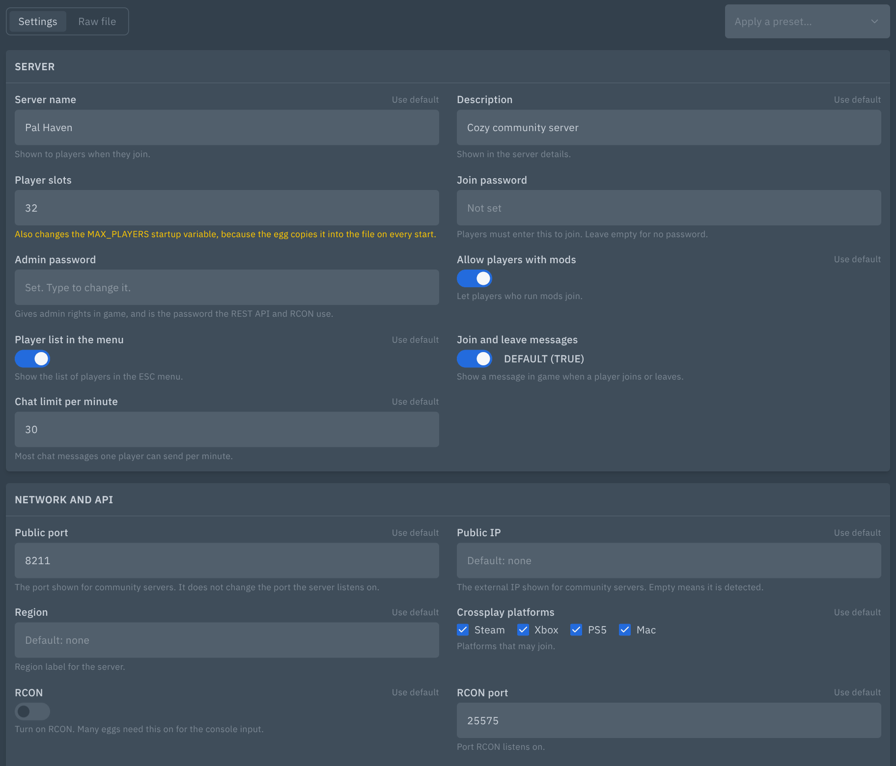
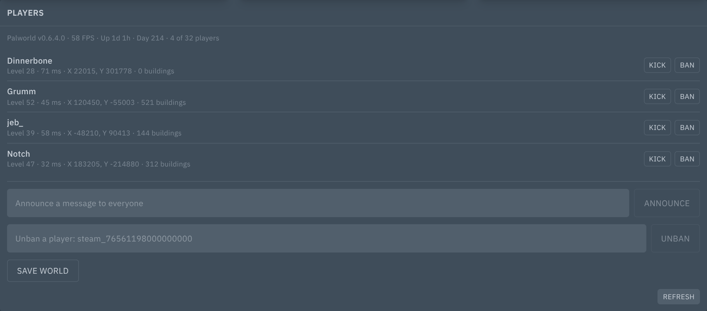
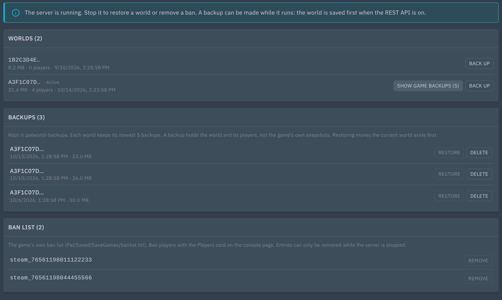

# Palworld Tools: settings, players, saves and bans

Adds a settings editor, a **Players** card, world backups and the ban list to Palworld servers in Pterodactyl 2.0.





## Features

- **Settings:** every option of `PalWorldSettings.ini` as a form with labels, help text, defaults and checks. Presets for Vanilla, 2x rates, 5x rates and Casual show what changes before you apply them. A raw editor is there for anything else.
- Unknown settings, their order and the spacing of the file are kept exactly as they were. Quoted names with commas and brackets are handled.
- When the file is empty, it starts from `DefaultPalWorldSettings.ini`.
- Every save keeps a `.bak` copy (the last five).
- Changes are written with the server stopped, so the game cannot overwrite them. Save and restart stops the server, writes the file and starts it again.
- Settings the egg fills from startup variables are marked. Changing them edits the startup variable instead.
- **Players:** a card under the console with who is online (level, ping, position, buildings), server version, FPS, uptime and in-game day. Kick, ban, unban, announce and save the world.
- **Saves:** list worlds, back up to `palworld-backups/<world>-<date>.tar.gz` (the newest N are kept), restore, delete backups. The game's own snapshots from `backup/world` can be restored too.
- A restore needs the server stopped and moves the current world aside first.
- **Ban list:** see and remove entries from `banlist.txt` while the server is stopped.
- Passwords are never sent to the browser. Without the settings permission they stay hidden and untouched.

## Requirements

- Pterodactyl Panel **2.0** (2.0.0-beta or newer)
- PHP 8.3+ (same as the panel)
- A Palworld egg with the `palworld` tag, or a startup command that contains `PalServer`
- No build step: the package ships prebuilt.

## Install

1. Copy the `.pteroext` file to your panel server.
2. Run, from the panel directory (usually `/var/www/pterodactyl`):

   ```
   sudo -u www-data php artisan p:extension:install /path/to/palworld-tools-1.0.1.pteroext --enable
   ```

   Or upload it under **Admin → Extensions**.
3. Hard-refresh the panel in your browser (Ctrl+Shift+R).

## Update

Same command with `--replace`:

```
sudo -u www-data php artisan p:extension:install /path/to/palworld-tools-1.0.1.pteroext --enable --replace
```

Settings and data are kept.

## Setup

- The pages and the card show on servers whose egg has the `palworld` tag, or whose startup contains `PalServer`.
- **REST API:** the Players card talks to the game's REST API. Turn it on with the button on the card, or set `RESTAPIEnabled=True` in the settings. The REST port must be one of the server's allocations (add it under the server's network settings). Only the server's own ports are used. Do not expose the port to the internet: it is protected by the admin password only, and Palworld serves it over plain HTTP, so the password travels unencrypted between the panel and the node. Use a private IP allocation for the REST port, or block the port in the node's firewall for everything except the panel host.
- **Egg startup variables:** some eggs rewrite `PalWorldSettings.ini` from startup variables on every start. Those settings are marked on the page, and saving them changes the variable. Values with commas, brackets or quotes can break such eggs, so the page warns before you save them.
- Backups go to `palworld-backups/`. Restored-over worlds are kept in `palworld-backups/replaced/` and are never removed automatically, so delete old ones in the file manager. A backup of a running server waits for the game to save first and does not remove old backups.

## Settings

Under **Admin → Extensions → Palworld Tools**:

| Setting | Options |
|---|---|
| Backups to keep per world | 1 to 50 (default 5) |

## Permissions (Subusers)

| Permission | Allows |
|---|---|
| `ext.palworld-tools.view` | See the Players card |
| `ext.palworld-tools.players` | Kick, ban, unban, announce, save the world |
| `ext.palworld-tools.settings` | Open and change the settings, including passwords |
| `ext.palworld-tools.saves` | Back up, restore and delete backups, edit the ban list |

Changing settings and saves also needs the core file and power permissions (`file.read`, `file.update`, `control.start`, `control.stop`). Server owners and admins have all of them.

## Support

Open an issue at https://github.com/Enforcer0952/pterodactyl-v2-extensions/issues. Please include your panel version and the error text or request ID.
