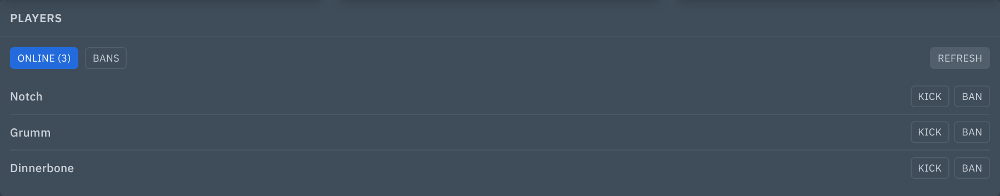
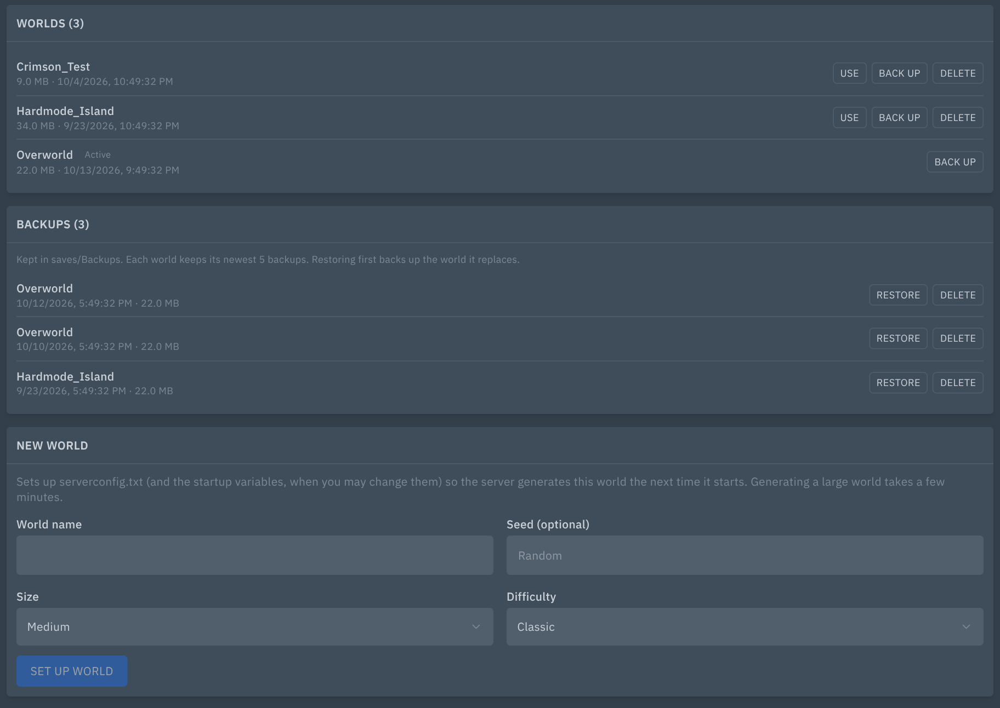
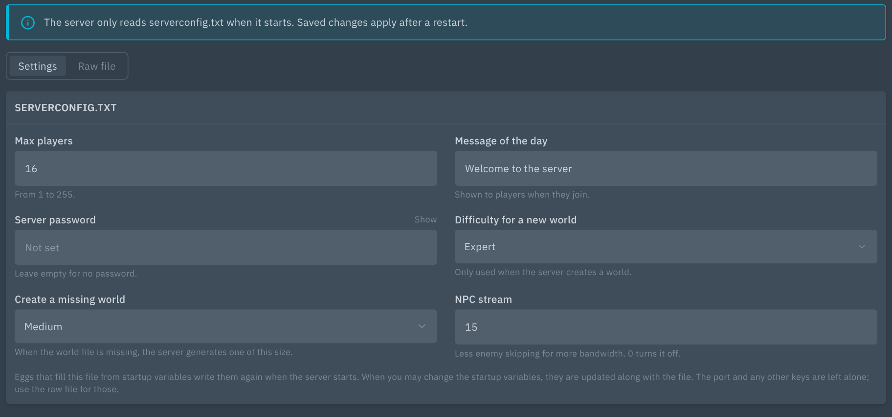
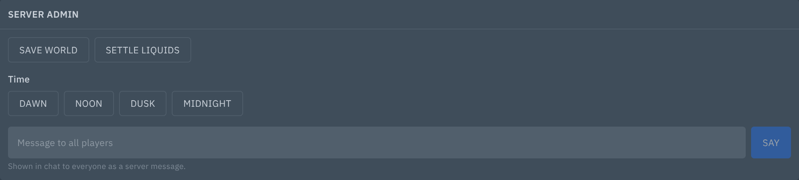

# Terraria Tools: players, worlds, backups and settings for Terraria servers

Adds a **Players** card, a **Server admin** card and console autocomplete under the console, plus **Worlds** and **Server settings** pages, to vanilla Terraria dedicated servers in Pterodactyl 2.0.






## Features

- **Players:** who is online (read with the `playing` command), with Kick and Ban. Ban asks for confirmation. The list follows joins and leaves in the console, with no polling, and has a Refresh button.
- **Ban list:** the entries in `banlist.txt` (or the file `banlist=` in `serverconfig.txt` points to), with name and address. Unban removes the lines while the server is stopped and keeps the old file as a `.bak`.
- **Server admin:** Save world, Settle liquids, the time buttons (Dawn, Noon, Dusk, Midnight) and a Say box that sends a message to everyone. Messages are one line, up to 200 characters.
- **Worlds:** every `.wld` file with size and date, and which one the server loads.
  - **Use:** make a world the active one (updates `world=` and `worldname=` in `serverconfig.txt`, and the `WORLD_NAME` startup variable when you may change it).
  - **Back up:** copies the world into `saves/Backups/<name>-<date>.wld`. A running server saves first. Each world keeps its newest backups (default 5, see Settings).
  - **Restore and delete backups:** restoring backs up the world it replaces first, and needs the server stopped.
  - **Delete world:** needs the server stopped, asks for confirmation and makes a backup first by default. Removes the `.wld`, `.wld.bak` and `.twld` files. The active world cannot be deleted.
  - **New world:** name, size, difficulty and seed. Sets `serverconfig.txt` (and the startup variables) so the server generates it on its next start.
- **Server settings:** a form for `maxplayers`, `motd`, `password`, `difficulty`, `autocreate` and `npcstream`, and a raw editor for the whole `serverconfig.txt`. Comments, unknown keys, repeated keys and line endings are kept. Every save keeps the old file as `serverconfig.txt.<date>.bak` (newest five stay). If the file changed since you opened it, the save is refused. The password is hidden from people who may not edit the file or the startup variables.
- **Console autocomplete:** command names and syntax hints for the vanilla console commands, and online player names after `kick` and `ban` (names with spaces work, no quotes needed). Tab completes, arrow keys choose.
- Input is validated, so a player name, message, world name or setting can never inject a second console command or reach outside the server folder.

## Requirements

- Pterodactyl Panel **2.0** (2.0.0-beta or newer; tested on 2.0-develop, October 2026)
- PHP 8.3+ (same as the panel)
- A **vanilla Terraria dedicated server** (1.4.x, no tShock) whose console is the server's own console, started with a `serverconfig.txt`.
- No build step: the package ships prebuilt.

## Install

1. Copy the `.pteroext` file to your panel server.
2. Run, from the panel directory (usually `/var/www/pterodactyl`):

   ```
   sudo -u www-data php artisan p:extension:install /path/to/terraria-tools-1.0.0.pteroext --enable
   ```

   Or upload it under **Admin → Extensions**.
3. Hard-refresh the panel in your browser (Ctrl+Shift+R).

## Update

Same command with `--replace`:

```
sudo -u www-data php artisan p:extension:install /path/to/terraria-tools-1.0.0.pteroext --enable --replace
```

Settings and data are kept.

## Setup

The cards and pages appear on servers whose egg has the `terraria` tag, **or** whose startup command contains `TerrariaServer` (so eggs tagged only `srcds` work too).

How it finds things:

| What | Where |
|---|---|
| Config | `serverconfig.txt` in the server folder |
| Worlds | `worldpath=` from the config, else `saves/Worlds` |
| Backups | a `Backups` folder next to the worlds folder (`saves/Backups`) |
| Ban list | `banlist=` from the config, else `banlist.txt` |

Eggs usually fill `serverconfig.txt` from startup variables each time the server starts (`WORLD_NAME`, `MAX_PLAYERS`, `SERVER_MOTD`, `PASSWORD`, `WORLD_SIZE`, `WORLD_DIFFICULTY`, `WORLD_SEED`, `NPCSTREAM`). So when you change a setting, switch worlds or set up a new one, the matching startup variable is changed too, if you have the **Startup → Update** permission and the egg lets users edit it. When it cannot be changed, the page tells you which variables to change on the Startup page.

Online players come from the `playing` command, so the console must show the server's output. The Players card needs the console permission for that.

## Settings

Under **Admin → Extensions → Terraria Tools**:

| Setting | Options |
|---|---|
| Backups to keep per world | 1 to 50 (default 5). Older backups are deleted after a new one is made. |

## Permissions (Subusers)

| Permission | Allows |
|---|---|
| `ext.terraria-tools.view` | See who is online (also needs Console) |
| `ext.terraria-tools.kick` | Kick |
| `ext.terraria-tools.ban` | Ban, see the ban list, unban (the list also needs File → Read content; unban needs File → Update) |
| `ext.terraria-tools.admin` | Admin commands (also needs Console), and the Server settings page (also needs File → Read and Read content; saving needs File → Update) |
| `ext.terraria-tools.worlds` | The Worlds page (also needs File → Read and Read content) |

The Worlds page also uses the panel's own file permissions for what it changes: File → Update to switch or set up a world, File → Create and Update to back up, File → Delete to delete. Starting a backup on a running server also needs Console. The password is only shown to people with File → Update or Startup → Update.

Server owners and admins have all of them.

## Support

Open an issue at https://github.com/Enforcer0952/pterodactyl-v2-extensions/issues. Please include your panel version and the error text or request ID.
